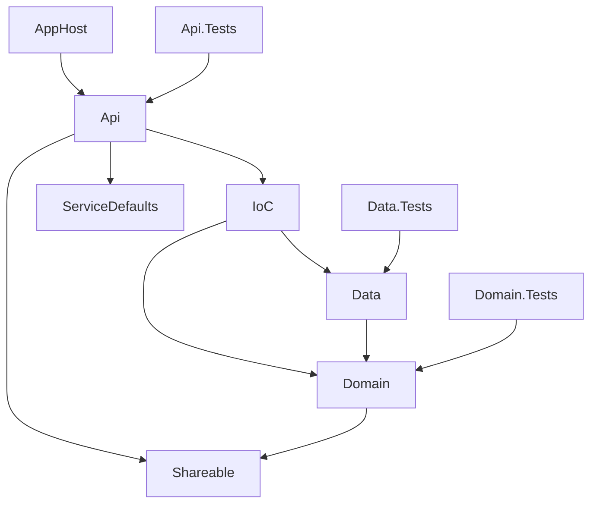

# Introduction

Esta especificação define a reorganização física e lógica da solução `Samba4Hub` (backend) para o padrão de pastas, camadas e referências da skill `personal-dotnet-developer`. O objetivo é apenas estrutural: nenhuma regra de negócio é criada ou alterada.

## 1. Purpose & Scope

- **Propósito**: alinhar nomes de projetos, pastas, referências, solução, AppHost e Dockerfile ao padrão.
- **Escopo**: todos os projetos em `Backend-Samba4Hub/Samba4Hub/`.
- **Fora de escopo**: novas features, EF Core/PostgreSQL, Serilog, pacotes de teste (FluentAssertions, NSubstitute, Bogus, Stryker) — tratados nas fases 03/04 ou em especificações futuras.
- **Público**: desenvolvedor do projeto e agentes de IA.
- **Premissa**: o repositório está limpo no git (somente `.vscode/` não rastreado), o que permite usar `git mv` preservando histórico.

## 2. Definitions

| Termo | Definição |
|---|---|
| Root | Pasta raiz da solução (contém `.slnx`, `src/`, `test/`). |
| Api | Projeto de entrada (Minimal APIs). |
| IoC | Projeto de composição de dependências (registro de serviços). |
| Data | Projeto de persistência (EF Core / repositórios). |
| Shareable | DTOs, constantes e tipos comuns sem dependências internas. |
| AppHost | Host de orquestração .NET Aspire. |
| ServiceDefaults | Observabilidade, health checks e resiliência padrão do Aspire. |

## 3. Requirements, Constraints & Guidelines

### Estado atual → estado alvo

| Atual | Alvo | Ação |
|---|---|---|
| `Samba4Hub/Samba4Hub/` (`Samba4Hub.csproj`) | `src/Samba4Hub.Api/` (`Samba4Hub.Api.csproj`) | Mover + renomear |
| — | `src/Samba4Hub.IoC/` | Criar (`classlib`) |
| `Samba4Hub.Infra/` | `src/Samba4Hub.Data/` | Mover + renomear |
| `Samba4Hub.Domain/` | `src/Samba4Hub.Domain/` | Mover |
| `Samba4Hub.Shareable/` | `src/Samba4Hub.Shareable/` | Mover |
| `Samba4Hub.ServiceDefaults/` | `src/Samba4Hub.ServiceDefaults/` | Mover |
| `Samba4Hub.AppHost/` | `src/Samba4Hub.AppHost/` | Mover |
| `Samba4Hub.Testes/` | `test/Samba4Hub.Api.Tests/` | Mover + renomear |
| — | `test/Samba4Hub.Domain.Tests/` | Criar (`xunit`) |
| — | `test/Samba4Hub.Data.Tests/` | Criar (`xunit`) |

### Estrutura alvo

```text
Backend-Samba4Hub/
├── .specs/
├── Samba4Hub.slnx
├── aspire.config.json
├── .dockerignore
├── src/
│   ├── Samba4Hub.Api/
│   ├── Samba4Hub.IoC/
│   ├── Samba4Hub.Data/
│   ├── Samba4Hub.Domain/
│   ├── Samba4Hub.Shareable/
│   ├── Samba4Hub.ServiceDefaults/
│   └── Samba4Hub.AppHost/
└── test/
    ├── Samba4Hub.Api.Tests/
    ├── Samba4Hub.Domain.Tests/
    └── Samba4Hub.Data.Tests/
```

### Requisitos

- **REQ-001**: A Root da solução passa a ser `Backend-Samba4Hub/` (o nível intermediário `Samba4Hub/` deixa de existir).
- **REQ-002**: Todos os projetos de implementação ficam em `src/` e todos os de teste em `test/`.
- **REQ-003**: Referências entre projetos seguem exatamente o grafo da seção 4.
- **REQ-004**: Namespaces e `RootNamespace` refletem o novo nome do projeto (`Samba4Hub.Api`, `Samba4Hub.Data`, `Samba4Hub.Api.Tests`).
- **REQ-005**: `AppHost.cs` usa `Projects.Samba4Hub_Api`, mantendo o nome de recurso `samba4hub`.
- **REQ-006**: `Dockerfile` atualizado para os novos caminhos e para `ENTRYPOINT ["dotnet", "Samba4Hub.Api.dll"]`.
- **REQ-007**: `Samba4Hub.slnx` com pastas de solução `/src/` e `/test/` espelhando as pastas físicas.
- **REQ-008**: `dotnet build` e `dotnet test` da solução executam sem erros ao final.

### Restrições

- **CON-001**: Movimentações feitas com `git mv` (preserva histórico). Nenhum arquivo de código é excluído.
- **CON-002**: Arquivos placeholder (`Class1.cs`, `UnitTest1.cs`, endpoint `weatherforecast`) **permanecem**. Remoção só com confirmação explícita, em etapa separada.
- **CON-003**: O processo `dotnet run` em execução precisa ser encerrado antes (bloqueia arquivos em `bin/obj`).
- **CON-004**: Versões de pacotes existentes não são alteradas (`net10.0`, Aspire SDK 13.5.4, xUnit 2.9.3).

### Diretrizes

- **GUD-001**: Precedência — em conflito entre skills, vale `personal-dotnet-developer`.
- **GUD-002**: Commit único e isolado da reestruturação, para revisão e rollback fácil.

## 4. Interfaces & Data Contracts

### Grafo de referências alvo



| Projeto | Referencia |
|---|---|
| Api | IoC, ServiceDefaults, Shareable |
| IoC | Data, Domain |
| Data | Domain |
| Domain | Shareable |
| Shareable | — |
| AppHost | Api |
| Api.Tests / Domain.Tests / Data.Tests | Api / Domain / Data |

> Hoje apenas `Samba4Hub → ServiceDefaults` e `AppHost → Samba4Hub` existem; as demais referências serão criadas.

## 5. Acceptance Criteria

- **AC-001**: Given a solução reestruturada, When `dotnet build Samba4Hub.slnx` é executado na Root, Then compila sem erros.
- **AC-002**: Given a solução reestruturada, When `dotnet test` é executado, Then todos os projetos de teste são descobertos e passam.
- **AC-003**: Given o AppHost, When executado, Then o recurso `samba4hub` sobe a Api normalmente.
- **AC-004**: `git log --follow` em arquivos movidos mostra o histórico anterior.
- **AC-005**: Nenhum projeto referencia uma camada fora do grafo da seção 4.

## 6. Test Automation Strategy

- **Test Levels**: nesta fase, apenas verificação de build e descoberta de testes.
- **Frameworks**: xUnit (existente). FluentAssertions, NSubstitute, Bogus e Stryker.NET entram na fase `04-testing.md`.
- **CI/CD Integration**: não existe pipeline hoje; fora de escopo.

## 7. Rationale & Context

- A estrutura atual (`Infra`, `Testes`, sem `IoC`, sem `src/`/`test/`) diverge do padrão adotado para criação e normalização de projetos.
- O projeto está em fase inicial (apenas templates), então o custo da migração agora é mínimo.
- Um projeto `IoC` separado evita que a Api referencie `Data` diretamente.

## 8. Dependencies & External Integrations

- **PLT-001**: .NET SDK 10.0.401 instalado; todos os projetos em `net10.0`.
- **PLT-002**: .NET Aspire AppHost SDK 13.5.4.
- **INF-001**: Docker (Dockerfile da Api) — caminhos precisam ser atualizados.

## 9. Examples & Edge Cases

```csharp
// AppHost.cs — após renomear o projeto
var builder = DistributedApplication.CreateBuilder(args);
builder.AddProject<Projects.Samba4Hub_Api>("samba4hub");
builder.Build().Run();
```

- **Edge**: `bin/` e `obj/` antigos com caminhos absolutos podem causar erro de build → executar `dotnet restore` após mover (sem excluir pastas automaticamente).
- **Edge**: `Samba4Hub.csproj.user` (perfil Docker do VS) acompanha o projeto e deve ser renomeado para `Samba4Hub.Api.csproj.user`.
- **Edge**: `UserSecretsId` do AppHost não muda (segredos locais preservados).

## 10. Validation Criteria

- Build e testes verdes (AC-001, AC-002).
- Árvore de pastas idêntica à da seção 3.
- Referências idênticas à tabela da seção 4.

## 11. Related Specifications / Further Reading

- `.specs/02-scaffolding.md` (próxima fase — comandos exatos)
- Skill `personal-dotnet-developer`
