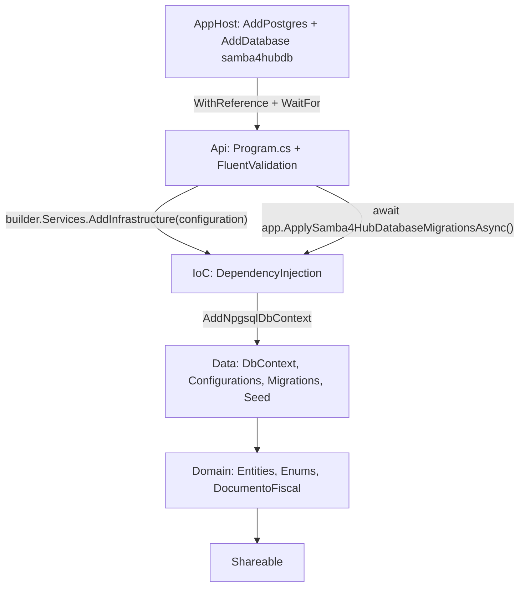
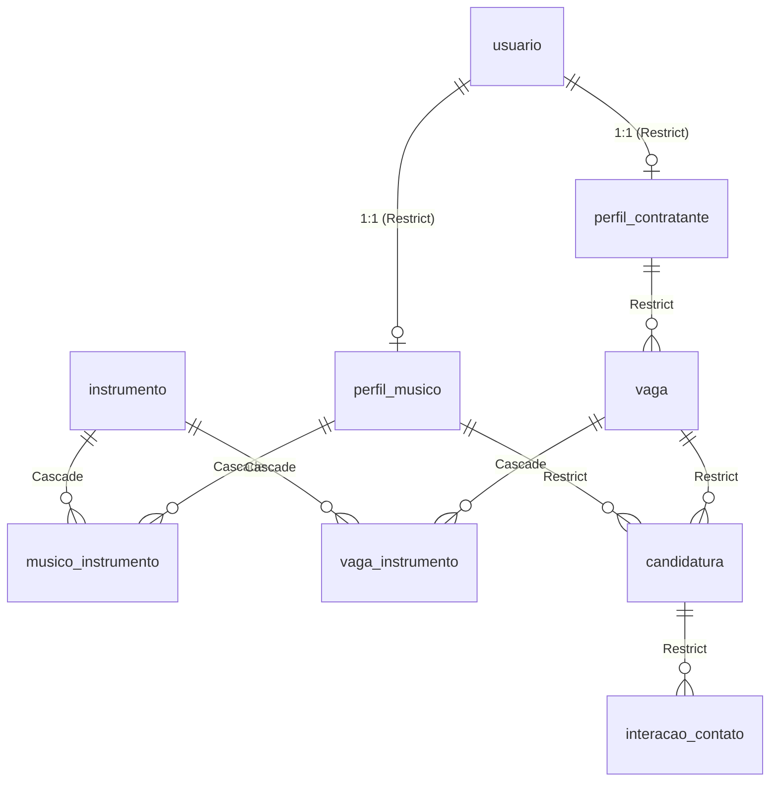

# Plano de Implementação — MVP Fase 1 (Modelagem de Dados Lean)

Plano para executar o *Master Prompt* de modelagem no repositório **real**, aplicando as skills `personal-dotnet-developer` (precedência), `dotnet-best-practices` e `create-specification`.

> [!IMPORTANT]
> **Versão 2.0 (Simplificada e Pragmática para MVP):**  
> Enums em C# persistidos diretamente como `integer` no PostgreSQL, **sem tabelas de lookup** e **sem constraints CHECK de enum no banco**. A integridade de entrada é garantida na camada de API com **FluentValidation**.

---

## 1. Divergências entre o Prompt e o Repositório (Regra 2)

| # | Prompt diz | Repositório real | Decisão Final |
|---|---|---|---|
| D1 | `.NET 9 / C# 13` | Todos os projetos em **`net10.0`**, SDK **10.0.401** (C# 14) | Usar **.NET 10 / EF Core 10** |
| D2 | `Samba4Hub/Samba4Hub.Infra/...` | **`src/Samba4Hub.Data/`** | Tudo de persistência/infra fica em `Samba4Hub.Data` |
| D3 | `Samba4Hub/Samba4Hub.Domain/...` | `src/Samba4Hub.Domain/` | `Entities\`, `Enums\` e `ValueObjects\` |
| D4 | `Samba4Hub/Samba4Hub/Program.cs` | `src/Samba4Hub.Api/Program.cs` | Api **não** referencia Data direto → registro via **IoC** |
| D5 | “Aspire + PostgreSQL via Npgsql” | AppHost **sem** recurso Postgres; **nenhum** pacote EF/Npgsql | Adicionar recurso Postgres no AppHost + pacotes |
| D6 | SQL com `GENERATED ALWAYS AS IDENTITY` | Prompt também exige `UseIdentityByDefaultColumn()` | Alinhar tudo para `BY DEFAULT` (permite seed) |
| D7 | “Não execute CLI” | `MigrateAsync()` sem migration **não cria nada** | Gerar `InitialCreate` em etapa separada sob confirmação |
| D8 | CNPJ “apenas dígitos” | CNPJ alfanumérico vigente desde jul/2026 | **Aceitar formato alfanumérico** (IN RFB 2.229/2024) |
| D9 | “Todas as tabelas com PK `long` identity” | Tabelas associativas puras | **PK composta** nas associativas (`musico_instrumento`, `vaga_instrumento`) |
| D10| Enums e integridade | Decisão arquitetural de MVP | **Enums como `integer`, sem CHECK de enum no banco; validação no request via FluentValidation** |

### Versões verificadas no NuGet (2026-10-11)

| Pacote | Projeto | Versão | Motivo |
|---|---|---|---|
| `Aspire.Hosting.PostgreSQL` | AppHost | **13.5.4** | Alinhado ao `Aspire.AppHost.Sdk/13.5.4` |
| `Aspire.Npgsql.EntityFrameworkCore.PostgreSQL` | IoC | **13.5.4** | Health check + OpenTelemetry + retry nativo |
| `Npgsql.EntityFrameworkCore.PostgreSQL` | Data | **10.0.3** | Suporte a `UseIdentityByDefaultColumn()` |
| `Microsoft.EntityFrameworkCore.Design` | Data | **10.0.12** | Design-time (`PrivateAssets=all`) |
| `FluentValidation.AspNetCore` | Api | **11.x** | Validação automática de modelos e DTOs de entrada |
| `dotnet-ef` (tool manifest local) | Root | **10.0.12** | Geração reproduzível de migrations e scripts |

---

## 2. Arquitetura e Fluxo



---

## 3. Modelo de Dados Lean (Sem Tabelas Redundantes)

O modelo possui **apenas as tabelas essenciais de negócio** (sem inchaço de 9 tabelas de lookup):



### 3.1 Mapeamento dos Enums como Inteiros
Todas as propriedades de enum são tipadas em C# e gravadas como `integer` de 4 bytes no PostgreSQL:

| Entidade | Propriedade C# | Coluna PostgreSQL | Tipo SQL | Enum C# correspondente |
|---|---|---|---|---|
| `Usuario` | `Tipo` | `tipo` | `integer` | `TipoUsuario` (1=Contratante, 2=Musico, 3=Ambos) |
| `PerfilContratante` | `Tipo` | `tipo` | `integer` | `TipoContratante` (1=PessoaFisica, 2=BarCasaNoturna, 3=Empresa) |
| `PerfilMusico` | `Modalidade` | `modalidade` | `integer` | `ModalidadeAtuacao` (1=Solo, 2=GrupoCompleto, 3=Ambos) |
| `Instrumento` | `Categoria` | `categoria` | `integer` | `CategoriaInstrumento` (1=HarmoniaCordas, 2=Percussao, 3=Vocal) |
| `Vaga` | `EstiloPredominante` | `estilo_predominante`| `integer` | `EstiloSamba` (1 a 5) |
| `Vaga` | `FormatoSolicitado` | `formato_solicitado` | `integer` | `FormatoVaga` (1 a 3) |
| `Vaga` | `Status` | `status` | `integer` | `StatusVaga` (1=Aberta ... 5=Expirada) |
| `Candidatura` | `Status` | `status` | `integer` | `StatusCandidatura` (1 a 4) |
| `InteracaoContato` | `IniciadoPor` | `iniciado_por` | `integer` | `OrigemInteracao` (1=Musico, 2=Contratante) |

> **Zero JOINs adicionais**: Carregar uma vaga ou candidatura lê o número diretamente da linha, com performance máxima.

---

## 4. Camada de Validação de Entrada: FluentValidation

Toda requisição externa (POST, PUT, PATCH) passa por validadores do **FluentValidation** na API:

```csharp
public class CriarVagaRequestValidator : AbstractValidator<CriarVagaRequest>
{
    public CriarVagaRequestValidator()
    {
        RuleFor(x => x.Titulo).NotEmpty().MaximumLength(120);
        RuleFor(x => x.Descricao).NotEmpty().MaximumLength(4000);
        RuleFor(x => x.Status).IsInEnum().WithMessage("Status da vaga informado é inválido.");
        RuleFor(x => x.EstiloPredominante).IsInEnum().WithMessage("Estilo de samba informado é inválido.");
        RuleFor(x => x.FormatoSolicitado).IsInEnum().WithMessage("Formato de vaga informado é inválido.");
        RuleFor(x => x.CacheOferecido).GreaterThanOrEqualTo(0)
            .When(x => !x.CacheACombinar)
            .WithMessage("O cachê deve ser informado quando não for a combinar.");
    }
}
```

- Valores inválidos são rejeitados com `400 Bad Request` antes de qualquer execução de domínio ou banco.

---

## 5. Árvore de Arquivos Alvo

```text
.specs/
└── modelagem-dados-mvp-fase1.md                         [NEW]    Spec única da modelagem
docs/
├── plans/plano-implementacao-mvp-fase1.md               [UPDATED]
└── notebooklm/samba4hub_modelagem_notebooklm.md         [UPDATED]
src/
├── Samba4Hub.AppHost/AppHost.cs                         [MODIFY] Postgres + database + WaitFor
├── Samba4Hub.Api/
│   ├── Program.cs                                       [MODIFY] AddSamba4HubData + ApplyDatabaseMigrationsAsync
│   └── Validators/ (Validadores FluentValidation)       [NEW]
├── Samba4Hub.IoC/DependencyInjection.cs                 [NEW]    AddSamba4HubData(IHostApplicationBuilder)
├── Samba4Hub.Domain/
│   ├── Enums/ (9 enums C#)                              [NEW]
│   ├── Entities/ (BaseEntity + 9 entidades operacionais)[NEW]
│   └── Extensions/DocumentoFiscalExtensions.cs          [NEW]    Extension methods para validação de CPF e CNPJ alfanumérico
└── Samba4Hub.Data/
    ├── Context/Samba4HubDbContext.cs                    [NEW]
    ├── EntityTypeConfiguration/ (9 classes)             [NEW]
    ├── Interceptors/AuditableEntityInterceptor.cs       [NEW]
    ├── Extensions/MigrationExtensions.cs                [NEW]
    ├── Seed/InstrumentoSeed.cs                          [NEW]    Taxonomia inicial de instrumentos
    ├── Migrations/20261011192800_InitialCreate.cs       [DONE]   Migration gerada via dotnet ef
    └── Scripts/init_schema.sql                          [DONE]   DDL PostgreSQL documentado
```

---

## 6. Registro de Decisões Atualizado (v2.0)

| ID | Tema | Decisão Final | Status |
|---|---|---|---|
| Q1 | Local da spec | Arquivo único: `.specs/modelagem-dados-mvp-fase1.md` | ✅ Decidido |
| Q2 | Enums e Integridade | **`integer` puro no banco (sem CHECK e sem tabelas de lookup); validação na API via FluentValidation** | ✅ Decidido |
| Q3 | CNPJ alfanumérico | Aceitar já no MVP (algoritmo da IN RFB 2.229/2024) | ✅ Decidido |
| Q4 | Tabelas associativas | PK composta (`musico_instrumento` e `vaga_instrumento`) | ✅ Decidido |
| Q5 | `init_schema.sql` | Documentação gerada a partir das migrations; não executável | ✅ Decidido |
